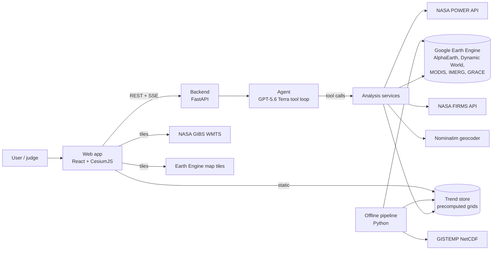
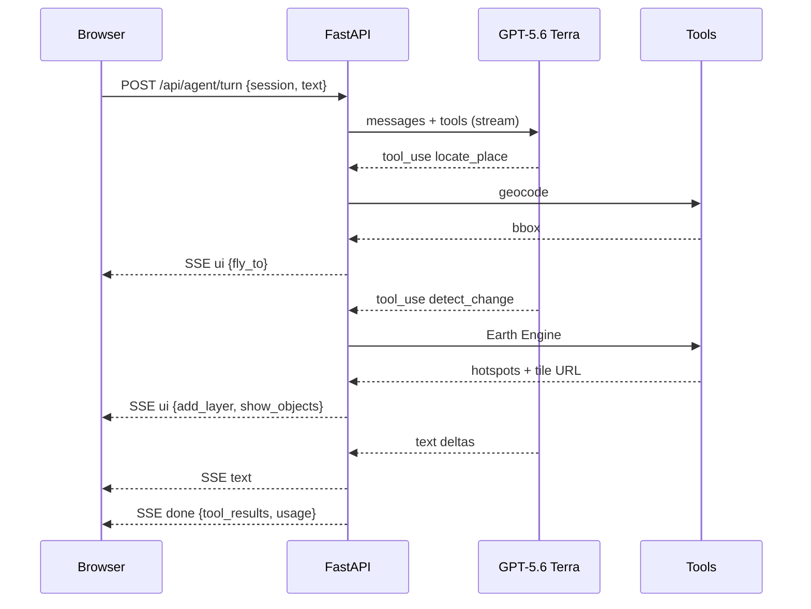
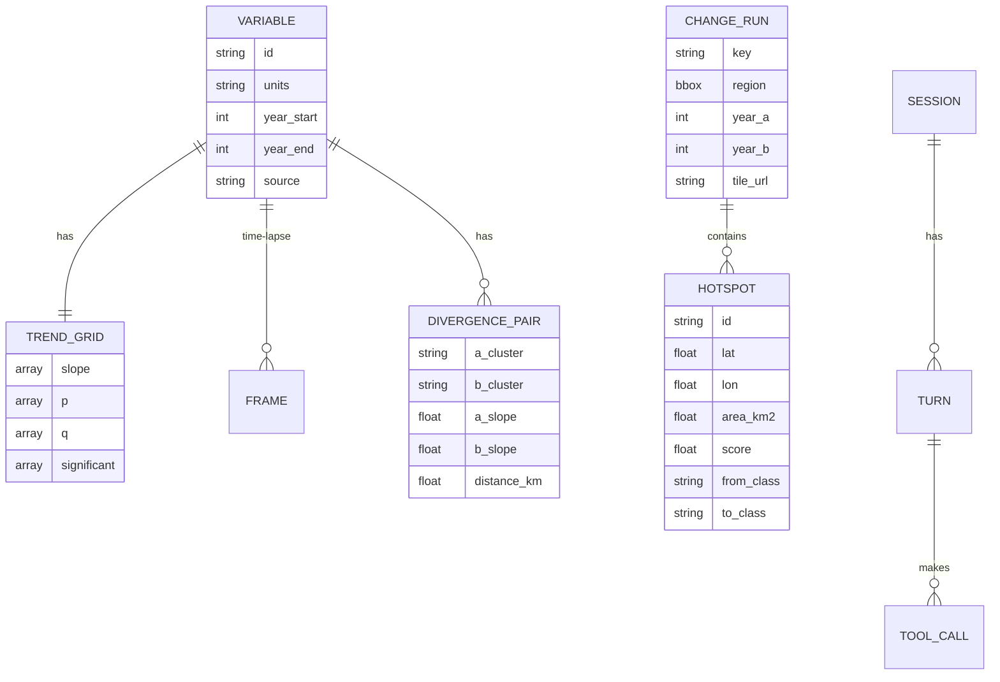

# Ground Truth: Architecture

> Status: v1 built and verified locally · 2026-11-13
> Research and sources: [docs/research.md](docs/research.md)

## 1. Overview

**Problem.** The NASA Space Apps 2026 challenge "Be An Earth System Trend Detective" asks for a tool that selects Earth science variables, shows how they change over time, and determines what is changing, where, how much, and whether the change is statistically significant. The hard part, in the brief's own words, is *selecting* which variables could indicate change.

**Product.** Ground Truth is an AI analyst on a 3D globe. You ask a question in plain English. It finds where the land surface changed (AlphaEarth embeddings, no variable chosen in advance), names what each place became (Dynamic World labels), and proves whether related NASA variables are trending significantly (Mann-Kendall with a bias-corrected autocorrelation correction, Theil-Sen slope, false discovery rate control; see [docs/methods.md](docs/methods.md)).

**Users.** Hackathon judges (primary, live demo), scientists and students exploring change, our own team.

**Jobs to be done.**
1. "Show me what changed around this place and prove it's real."
2. "Where on Earth is this variable trending significantly, and by how much?"
3. "Where does the same variable trend in opposite directions?"
4. "How unusual is right now compared with normal, and what's happening live?"

**Success metrics (measurable).**
- Our global-mean GISTEMP trend matches NASA GISS's published value for the same period to within ±0.02 °C/decade.
- Our vectorized Mann-Kendall agrees with `pymannkendall` (p-value within 1e-6, same trend label) on 1,000 sampled grid cells per variable.
- 90 % of a 25-question eval set answered with correct tool use and numbers that exactly match tool output.
- Agent answer: first streamed token < 3 s, full answer < 25 s at the 90th percentile.
- Globe holds 50+ fps on the demo laptop with all layers on.

## 2. Scope

**In scope (v1, demo-ready).**
- Ask-anything agent that drives the globe (fly-to, show layers, open objects).
- Change discovery for any region up to 100 × 100 km, any two years 2017–2025, with clickable hotspot objects and from → to labels.
- Global significance maps for four NASA variables: temperature (GISTEMP), vegetation (MODIS NDVI), rainfall (GPM IMERG), land water storage (GRACE).
- Time-lapse playback of each variable, year by year.
- Click-anywhere case file: time series, Sen's slope, p-value, verdict.
- Divergence finder for each variable.
- Three time-scales per place: trend, now vs normal (NASA POWER), live fires (FIRMS).
- Exportable case card (PNG).
- A "Checks" view showing our validation results against published science.

**Out of scope (later).** Accounts and sharing, deployment to a public URL, voice input, sea ice (NSIDC; optional fifth variable if time allows), sub-annual change detection with raw Sentinel-2, forecasting, causal attribution.

**Constraints.** Runs locally only; no GitHub push (user decision). Hackathon window 14–15 Nov 2026. Free data only. The OpenAI API is the only paid service ($50 credit available).

## 3. Requirements

**Functional.**
- F1. A user question in natural language produces a streamed answer plus globe actions (fly-to, layers, objects) within one turn.
- F2. `detect_change(region, year_a, year_b)` returns a change layer and up to 20 hotspot objects, each with centroid, area, mean change score, and from → to land-cover labels.
- F3. For each of the four variables, a precomputed global grid of Theil-Sen slope, corrected p-value, and FDR-adjusted significance.
- F4. Non-significant cells render grey; significant cells render on a diverging scale by slope.
- F5. Clicking any point returns that cell's yearly series, slope with units per decade, p-value, and a verdict string built from the numbers, not from the language model.
- F6. Time-lapse plays yearly frames for a variable with a scrubber.
- F7. `find_divergence(variable, region?)` returns ranked pairs of significant opposite-sign clusters with their stats.
- F8. "Now vs normal" for any point: last 30 days of NASA POWER daily temperature and rainfall against the 1991–2020 climatology for the same days.
- F9. Live fires from FIRMS for the last 24 h, refreshed every 10 minutes.
- F10. Export the current case as a PNG with the globe snapshot, finding, slope, p-value, and data sources.
- F11. Checks view: the validation table from §13.

**Non-functional.**
- Latency: cached point queries < 300 ms; change detection < 10 s for a 60 km region; first agent token < 3 s.
- Honesty: every number shown in the UI comes from a tool result. The agent may explain numbers but never invent them (enforced in §7).
- Accessibility: keyboard reachable controls, visible focus, `prefers-reduced-motion` honoured, colour scales readable for colour-blind viewers (diverging blue–orange, not red–green).
- Cost ceiling: < $0.15 per agent question on average, measured during evals; hard cap per turn (§7).
- Security: keys only in `.env`, never sent to the browser.

## 4. System context

**A request's path.** The user asks "What changed around Lagos since 2018?" The browser posts to `/api/agent/turn` and opens an SSE stream. The agent calls `locate_place("Lagos")`, then `detect_change(bbox, 2018, 2024)`. The backend runs the AlphaEarth comparison in Earth Engine, extracts hotspots, labels them with Dynamic World, caches the result, and returns compact JSON plus a tile URL. The backend forwards UI commands (`fly_to`, `add_layer`, `show_objects`) over SSE as they happen, then streams the agent's text. The case-file panel renders numbers straight from the tool results.

## 5. Tech stack

| Layer | Choice | Version | Why | Rejected |
|---|---|---|---|---|
| Globe | CesiumJS | 1.147 | True 3D globe, imagery/terrain providers, camera flyTo, entity picking; proven by God's Eye View | globe.gl (weaker geospatial accuracy, no WMTS), deck.gl (flatter feel, globe view less mature) |
| UI framework | React + TypeScript | 19.3 | Component model for panels, typed API contracts | — |
| Build | Vite | 8.3 | Single-screen app with a Python backend; Cesium's static assets are simple to serve with Vite. See ADR-3. | Next.js (global default, but SSR adds nothing here and Cesium needs client-only loading and asset copying) |
| Styling | Tailwind CSS | 4.3 | Token-driven design system | — |
| Motion | GSAP (+ SplitText) and Motion | 3.15 / 14.13 | Intro choreography with GSAP, panel transitions with Motion; per the global motion rules | — |
| State | Zustand + TanStack Query | 5.1 / 5.107 | Small global UI store; cached server queries | Redux (heavier) |
| Backend | FastAPI + Uvicorn | 0.162 / 0.54 | Async Python, SSE support, same language as Earth Engine and statistics | Node backend (would split the data stack) |
| Agent | OpenAI Python SDK, Responses API with our own tool loop | 3.50 | Function calling with strict schemas; our loop enforces limits and emits UI events (ADR-9) | Claude API (no credit on the account), Agents SDK (more than we need) |
| Earth data | earthengine-api | installed | AlphaEarth and NASA collections without downloading planet-scale files | Raw Earthdata downloads (too slow for a weekend) |
| Stats | NumPy (vectorized MK), pymannkendall (reference) | 1.4.3 | Fast whole-grid computation, validated against the reference library | statsmodels only (no MK) |
| Gridded IO | xarray + netCDF4 | 2026.9 / 1.7.5 | Read GISTEMP NetCDF | — |
| Cache | On-disk JSON and NPZ under `data/cache` | — | Local-only, no database needed | Redis/Postgres (unnecessary locally) |

## 6. Components

**6.1 Offline pipeline (`pipeline/`).** Builds the trend store. For each variable: fetch annual means (or totals) for complete years on a 0.5° grid (temperature stays on GISTEMP's native 2° grid; resampling it finer would fake detail) (temperature 1980–2025, NDVI 2001–2025, rainfall 2001–2024, water 2003–2023), compute per-cell Theil-Sen slope, corrected p-value (docs/methods.md), and Benjamini-Hochberg significance, then write a series cube, a trend grid, one PNG overlay per year (time-lapse), a significance overlay PNG, and divergence clusters. Idempotent: skips steps whose outputs exist unless `--force`. Failure: stops with the step and variable named; nothing partial is published.

**6.2 Trend store (`data/derived/`).** Per variable: `series.npz` (years × lat × lon, float32), `trend.npz` (slope, p, q, significant), `frames/{year}.png`, `significance.png`, `divergence.json`, `meta.json` (units, period, source, citation). Read-only at runtime; loaded into memory at backend start (~60 MB total).

**6.3 Backend (`server/`).** FastAPI app. Modules: `trends` (point and region queries against the store), `change` (AlphaEarth and Dynamic World via Earth Engine), `nowcast` (NASA POWER), `fires` (FIRMS proxy with 10-minute cache), `geo` (Nominatim with cache and a 1 request/second limit), `agent` (tool loop and SSE). Earth Engine calls run in a thread pool with a 30 s timeout and a cache keyed by (region, years).

**6.4 Web app (`web/`).** Cesium viewer with keyless imagery (GIBS BlueMarble, GIBS daily true colour, dark label tiles). Panels: Ask bar and conversation, Layers, Timeline (time-lapse), Case File (selected object or point), Checks. A typed command bus applies agent UI commands to the viewer. Failure: when the backend is unreachable, the globe and static layers still work and the Ask bar shows the error.

## 7. AI / agent architecture

**Pattern: a single agent loop with tools,** with hard step and cost limits. One question needs a short, mostly sequential chain of tool calls on shared context (place → change → trends → answer), so multi-agent would multiply cost without benefit. Parallel tool calls are allowed within a turn (for example two `trend_at_point` calls).

**Model.** OpenAI `gpt-5.6-terra` through the Responses API, `reasoning.effort: "low"` to start, streaming, strict function schemas, conversation carried with `previous_response_id`. Verified 2026-11-13: with instructions it calls the right tool in 2–5 s; without instructions it answered from memory instead of calling tools, so the system instructions are mandatory. Effort will be tuned against the eval set (§13), measuring quality per completed question. Fallback model if Terra is slow or unavailable: `gpt-5.5`.

**Tools (all `strict: true`, typed schemas, compact JSON results).**

| Tool | Input | Output (to model) | Side effect |
|---|---|---|---|
| `locate_place` | name | lat, lon, bbox, display name | `fly_to` |
| `detect_change` | bbox (≤ 100 km), year_a, year_b (2017–2025) | summary stats + top hotspots (id, centroid, area_km2, score, from, to) | `add_layer` change tiles, `show_objects` |
| `trend_at_point` | lat, lon, variable | years, values (trimmed), slope/decade, units, p, significant, period | `select_point` |
| `trend_in_region` | bbox, variable | regional-mean stats, % of cells significant up / down | `add_layer` significance |
| `find_divergence` | variable, optional bbox | top 3 opposite-sign pairs with stats | `show_objects` pairs |
| `now_vs_normal` | lat, lon | 30-day anomaly for temperature and rainfall | none |
| `live_events` | bbox | fire count and strongest detections (last 24 h) | `add_layer` fires |
| `set_view` | layer toggles, time-lapse year | ack | UI only |

**Honesty guardrails.**
- System prompt: numbers must come from tool results; say "not statistically significant" when q ≥ 0.05; never claim causes.
- The Case File renders tool outputs directly. The agent's prose sits beside them, never replaces them.
- A post-turn checker parses numbers in the agent's text and flags any that do not appear in that turn's tool results (logged and counted in evals).

**Limits.** Max 8 tool calls per turn, max 2 `detect_change` calls per turn, `max_tokens` 8,000 for the answer, 60 s wall-clock per turn, conversation compaction past 100k tokens. Tool errors return `is_error: true` with an actionable message (for example "region too large: 240 km wide, max 100 km").

**Prompt injection.** Tool results (place names, dataset metadata) are data. Tools are read-only and cannot reach the file system or arbitrary URLs.

**Context.** Stable system prompt and tool list first for prompt caching; conversation history per browser session kept in memory on the server.

**Fallbacks.** On API failure or missing key, the UI stays fully usable without the agent (layers, clicking, divergence, checks all work directly).

## 8. Data model

Retention: the trend store is regenerated by the pipeline; change runs and fire results are cache files that can be deleted at any time. No personal data is stored.

## 9. API design

All JSON. Errors return `{error: {code, message}}` with 400 (bad input), 404 (unknown variable), 502 (upstream data service failed), 504 (upstream timeout).

| Method | Path | Request | Response |
|---|---|---|---|
| GET | `/api/variables` | — | list of variables with units, periods, sources |
| GET | `/api/trend/point` | `lat, lon, variable` | series + stats + verdict |
| GET | `/api/trend/region` | `bbox, variable` | regional stats |
| GET | `/api/change` | `bbox, year_a, year_b` | tile URL + hotspots |
| GET | `/api/divergence` | `variable, bbox?` | pairs |
| GET | `/api/now` | `lat, lon` | anomalies |
| GET | `/api/fires` | `bbox?` | GeoJSON points |
| GET | `/api/checks` | — | validation results |
| POST | `/api/agent/turn` | `{session_id, text}` | `text/event-stream`: `ui`, `text`, `tool`, `error`, `done` events |
| GET | `/static/derived/...` | — | overlays and frames |

Rate limits: the agent endpoint allows one concurrent turn per session; geocoding is throttled to 1 request/second to respect Nominatim's policy.

## 10. Key flows

**Ask about a place** (sequence diagram in §7). Failure paths: geocoder finds nothing → agent asks for a more specific place; Earth Engine timeout → tool error, agent says so and offers a smaller area; no OpenAI key → Ask bar shows "Agent unavailable: add OPENAI_API_KEY", everything else works.

**Click anywhere.** Browser picks lat/lon → `GET /api/trend/point` for the active variable plus `GET /api/now` → Case File renders series, slope, p-value, verdict, anomaly. Ocean click on a land-only variable → "No data here (land-only variable)".

**Time-lapse.** Timeline loads `frames/{year}.png` for the active variable as a single-tile imagery layer and cross-fades on play. Frames are preloaded for the next two years.

**Find divergence.** Button or agent tool → pairs from `divergence.json` → globe shows both clusters and an arc between them, Case File shows both trends side by side.

**Export case card.** Renders the Cesium canvas (created with `preserveDrawingBuffer: true`, otherwise the snapshot is blank) plus Case File data into an offscreen canvas → PNG download.

## 11. Security & privacy

- Secrets in `.env` (git-ignored, mode 600): `OPENAI_API_KEY`, `FIRMS_MAP_KEY`, `EE_PROJECT`, optional `EARTHDATA_TOKEN`. The browser never sees them; FIRMS and Earth Engine are proxied by the backend. Earth Engine tile URLs are short-lived tokens scoped to one map.
- Earth Engine authenticates with the user's local credentials from `earthengine authenticate` (done in their own terminal).
- The backend binds to `127.0.0.1` only, and CORS allows only the local web app origin.
- Threats: prompt injection via place names (mitigated: read-only tools, data-only treatment); runaway cost (per-turn limits, §7); upstream abuse (caching, throttling).
- No personal data collected.

## 12. Reliability & observability

- Timeouts: Earth Engine 30 s, POWER 20 s, FIRMS 15 s, Nominatim 10 s; one retry with backoff on network errors.
- Caching makes repeat demo questions instant; a `make warm` step pre-runs the demo questions.
- Structured JSON logs per request; per agent turn we log tool calls, latency, tokens, and cost to `data/cache/traces.jsonl`.
- `/api/health` reports Earth Engine, POWER, FIRMS, and OpenAI reachability.

## 13. Testing strategy

- **Statistics unit tests:** vectorized MK and Sen's slope against `pymannkendall` on synthetic series (trend, no trend, autocorrelated, ties, missing years) and 1,000 sampled real cells per variable.
- **Science validation (shown in the Checks view):** global-mean GISTEMP trend against NASA GISS's published value for the same period; regional sanity checks (for example greening in the Sahel, water loss in northern India and the Central Valley, as reported in published studies), each pass/fail with its source.
- **Backend integration tests:** every endpoint against cached fixtures, plus live smoke tests marked `@live`.
- **Agent evals:** 14 questions (planned 25; `backend/scripts/agent_eval.py`) (places, variables, divergence, edge cases such as ocean points and too-large regions). Code-graded: correct tools called, numbers in text match tool results, significance wording matches q. Run on prompt or model changes.
- **E2E:** Playwright drives the app: load, ask a question, see a fly-to and objects, click a point, play the time-lapse, export a card. Plus the motion check required by the motion-web skill.

## 14. Deployment & environments

Local only. Backend on 127.0.0.1:8765, web app on :5179 (8000 and 5173 are used by other projects on this machine). `make setup` (Python venv + npm install), `make pipeline` (builds the trend store, ~20–40 min once), `make dev` (backend on :8000, web on :5173), `make test`, `make warm`. Environment variables: see `.env.example`. Cost: Earth Engine noncommercial (free), NASA services free, OpenAI API cost per question measured during evals and reported (measured during evals and reported).

## 15. Milestones

Ordered so the demo works as early as possible. The line marks what must exist before judging.

| # | Milestone | Acceptance criteria |
|---|---|---|
| M1 | Statistics core | ✅ Done 2026-11-13: false alarms 3.2–7.9 %, power 63–100 % (docs/methods.md) |
| M2 | Pipeline: 4 variables | ✅ Done 2026-11-13: 4 stores built; GISTEMP check +0.210 vs +0.207 °C/decade; 5/5 regional checks pass |
| M3 | Backend API | ✅ Done 2026-11-13: all endpoints with offline + live tests (agent endpoint comes with M6) |
| M4 | Globe app | ✅ Done 2026-11-13: globe, 3 base maps, significance maps, time-lapse, Case File, Checks view; browser walkthrough with no console errors |
| M5 | Change discovery | ✅ Done 2026-11-13: hotspots with from → to labels over Sentinel-2 imagery; divergence pairs with palette colours |
| M6 | Agent | ✅ Done 2026-11-13: streaming analyst drives the globe; 14/14 eval questions pass, median 7.7 s |
| — | **Demo line** | |
| M7 | Divergence + live layer + now vs normal | ✅ Done 2026-11-13 |
| M8 | Polish | ✅ Done 2026-11-13: intro sequence, Checks view (science, method, analyst eval), case card PNG, 12 demo places pre-computed, 1280 px layout. Added: live voice (gpt-realtime-2.1) |

## 16. Risks & open questions

**Risks.**
- Pipeline time: global Earth Engine exports may be slow. Mitigation: 0.5° grid, one year per request, cached, run overnight if needed.
- Change detection on large regions is slow at 10 m. Mitigation: cap at 100 km, compute hotspots at 30–60 m scale.
- Dynamic World labels can be noisy for a single year. Mitigation: use the most frequent label across the whole year.
- Agent latency (13 s on a first untuned call). Mitigation: low effort, streaming, UI actions sent before the prose finishes.
- Scope versus a two-day event. Mitigation: the demo line in §15.

**Open questions for you.**
1. ~~AI key~~ Resolved: OpenAI key in `.env`, model `gpt-5.6-terra` verified.
2. **Hackathon rules on prior work.** Can code written before the event starts be submitted? If not, today's work should stay limited to planning and data checks.
3. **Vite instead of Next.js** (ADR-3). OK?

## 17. Decisions log

| # | Date | Decision | Why | Alternatives |
|---|---|---|---|---|
| 1 | 2026-11-13 | Two engines: AlphaEarth for discovery, NASA long records for significance | AlphaEarth has 9 annual steps (too few for trend tests) but finds change in anything | Embeddings only; NASA variables only |
| 2 | 2026-11-13 | Build and run locally, no GitHub | User decision | Private repo |
| 3 | 2026-11-13 | Vite + React instead of Next.js | Single-screen app, Python backend, Cesium is client-only | Next.js App Router |
| 4 | 2026-11-13 | Single agent loop, not multi-agent | Short sequential tool chains on shared context | Orchestrator–workers |
| 5 | 2026-11-13 | Precompute global trend grids offline | Instant, demo-proof; whole-grid stats are too slow per request | Compute on demand in Earth Engine |
| 6 | 2026-11-13 | Dynamic World for from → to labels | Annual land-cover labels since 2015 at 10 m, already in Earth Engine | Classify embeddings ourselves |
| 7 | 2026-11-13 | Keyless imagery (GIBS) instead of Cesium ion | No extra account, NASA imagery fits the story | Cesium ion token |
| 8 | 2026-11-13 | 0.5° grid for NDVI, rainfall and water; native 2° for GISTEMP | Comparable maps at a manageable size (~260k cells) without inventing temperature detail | One common grid for all |
| 9 | 2026-11-13 | OpenAI `gpt-5.6-terra` for the agent instead of Claude | User has OpenAI credit; model verified on the account with working tool calls | Claude Opus 5.5, Gemini free tier |
| 10 | 2026-11-13 | Bias-corrected AR(1) variance correction instead of Hamed-Rao | Simulation: Hamed-Rao gave 7–22 % false alarms on 21–45 year records; ours 2.7–6.5 % with 73–100 % power (docs/methods.md) | Hamed-Rao, pre-whitening (well calibrated but misses 24–73 % of strong trends) |
| 11 | 2026-11-13 | Quadratic detrending + worst-case Monte Carlo check | Linear detrending called Greenland's 18 straight annual declines non-significant (p = 0.12); fix gives p < 0.001 and adds ≤ 0.3 pp false alarms | Monte Carlo with estimated persistence (false alarms up to 16 %) |
| 12 | 2026-11-13 | Divergence regions found within 30° tiles | Planet-wide warming formed one connected region with a meaningless centre | Global connected components |
| 13 | 2026-11-13 | Sentinel-2 cloudless (EOX, CC BY-NC-SA) as a third base map, auto-selected for change detection | NASA GIBS base maps stop at ~500 m; change hotspots need 10 m context | Esri World Imagery (licence less clear), GIBS MODIS 250 m |
| 14 | 2026-11-13 | Live voice: OpenAI `gpt-realtime-2.1` over WebRTC, ephemeral client secrets minted by the backend, tool calls executed by the backend | User asked for the latest OpenAI live voice model; verified on the account; secrets keep the real key off the browser | Text-to-speech on text answers (not live) |
| 15 | 2026-11-13 | Analysts must use regional tools for regions | Voice test answered "Greenland is gaining water" from the ice-sheet centre point; regional average is −748 mm/decade | Point queries everywhere |
